# Architecture Gallery

Interview-facing architecture pack for the DevOps portfolio. Every diagram has **editable source** and a **rendered SVG/PNG** for GitHub.

**Visual language:** navy control plane · teal data path · amber decision/approval · crimson failure/block.

<p align="center">
  
</p>

## Open these first in an interview

| Diagram | What it proves | Preview |
|---------|----------------|---------|
| [C4 containers](./rendered/10-c4-containers.svg) | Portfolio as a coherent system, not random repos |  |
| [CI/CD quality gates](./rendered/01-cicd-pipeline.svg) | Fail-closed promotion |  |
| [Progressive delivery](./rendered/04-k8s-progressive-delivery.svg) | Canary + error-rate gate |  |
| [Canary sequence](./rendered/05-canary-rollback-sequence.svg) | Exact promote/rollback control flow |  |
| [Failure recovery](./rendered/06-failure-recovery.svg) | Detect → triage → mitigate → learn |  |
| [Terraform remote state](./rendered/03-terraform-remote-state.svg) | Concurrent-safe IaC |  |
| [IAM / secrets threat model](./rendered/09-iam-secrets-threat-model.svg) | Trust boundaries |  |

## Full catalog

| # | Topic | Source | SVG | PNG |
|---|-------|--------|-----|-----|
| 00 | Portfolio system context | [mmd](./sources/00-portfolio-system-context.mmd) | [svg](./rendered/00-portfolio-system-context.svg) | [png](./rendered/00-portfolio-system-context.png) |
| 01 | CI/CD pipeline & gates | [mmd](./sources/01-cicd-pipeline.mmd) | [svg](./rendered/01-cicd-pipeline.svg) | [png](./rendered/01-cicd-pipeline.png) |
| 02 | Multi-stage containers | [mmd](./sources/02-container-multistage.mmd) | [svg](./rendered/02-container-multistage.svg) | [png](./rendered/02-container-multistage.png) |
| 03 | Terraform remote state | [mmd](./sources/03-terraform-remote-state.mmd) | [svg](./rendered/03-terraform-remote-state.svg) | [png](./rendered/03-terraform-remote-state.png) |
| 04 | K8s progressive delivery | [mmd](./sources/04-k8s-progressive-delivery.mmd) | [svg](./rendered/04-k8s-progressive-delivery.svg) | [png](./rendered/04-k8s-progressive-delivery.png) |
| 05 | Canary rollback sequence | [mmd](./sources/05-canary-rollback-sequence.mmd) | [svg](./rendered/05-canary-rollback-sequence.svg) | [png](./rendered/05-canary-rollback-sequence.png) |
| 06 | Failure & recovery | [mmd](./sources/06-failure-recovery.mmd) | [svg](./rendered/06-failure-recovery.svg) | [png](./rendered/06-failure-recovery.png) |
| 07 | Observability incident path | [mmd](./sources/07-observability-incident.mmd) | [svg](./rendered/07-observability-incident.svg) | [png](./rendered/07-observability-incident.png) |
| 08 | Network / data / control flows | [mmd](./sources/08-network-data-control-flows.mmd) | [svg](./rendered/08-network-data-control-flows.svg) | [png](./rendered/08-network-data-control-flows.png) |
| 09 | IAM & secrets threat model | [mmd](./sources/09-iam-secrets-threat-model.mmd) | [svg](./rendered/09-iam-secrets-threat-model.svg) | [png](./rendered/09-iam-secrets-threat-model.png) |
| 10 | C4 container view | [mmd](./sources/10-c4-containers.mmd) | [svg](./rendered/10-c4-containers.svg) | [png](./rendered/10-c4-containers.png) |
| — | Flagship draw.io board | [drawio](./sources/flagship-platform.drawio) | open in [diagrams.net](https://app.diagrams.net/) | — |
| — | Hand-crafted hero SVG | — | [svg](./rendered/hero-platform.svg) | — |

## How to edit / re-render

```bash
# Edit Mermaid sources under sources/*.mmd then:
./docs/architecture/scripts/render-all.sh

# Edit the flagship board:
# open docs/architecture/sources/flagship-platform.drawio in https://app.diagrams.net/
```

Theme tokens live in `sources/theme.json`.

## Consistency rule

If implementation changes (new gate, new rollback path, new trust boundary), update the matching `.mmd` / `.drawio` and re-render before calling the docs done.
