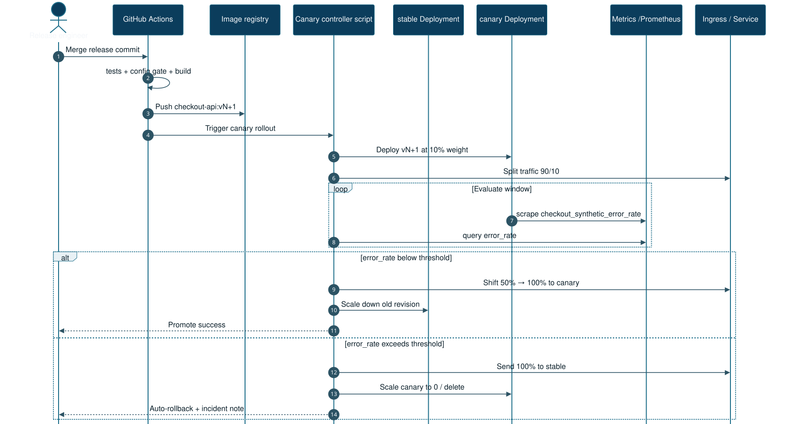

# Kubernetes Progressive Delivery

Canary rollout for `checkout-api` with an error-rate gate and automatic rollback.

**Resume mapping:** B02, B06, B07. Diagrams: [progressive delivery](../../docs/architecture/rendered/04-k8s-progressive-delivery.svg) · [canary sequence](../../docs/architecture/rendered/05-canary-rollback-sequence.svg)

<p align="center">
  
</p>

<p align="center">
  
</p>

## Problem

A new revision should take traffic gradually. If `checkout_synthetic_error_rate` reaches the threshold, traffic returns to the stable Deployment and the canary scales to zero.

## Control flow

`controller/canary.py` is the decision core:

1. Candidate starts at **10%** ingress weight.
2. With enough samples and error rate **below 0.05**, weight moves **10 → 50 → 100**.
3. At 100%, the previous stable revision scales to **0**.
4. If error rate is **greater than or equal to 0.05**, weight returns to **0** and canary replicas return to **0**. Stable replicas stay up.
5. Fewer than 20 samples holds the current weight, including when the error rate is already high.

The threshold matches the Prometheus rule in `projects/observability-incident-lab`.

Ingress-nginx implements the weight with two ClusterIP Services (`checkout-stable`, `checkout-canary`) and a canary Ingress. One Service cannot express 10/50/100 weights, so the diagram shows both Services. The ALB/Route53 shape is an example manifest only: `docs/ingress-alb.example.yaml`. It is not applied.

## Run without a cluster

```bash
cd projects/k8s-progressive-delivery
python3 -m pytest -q
./scripts/demo-canary.sh
./scripts/render-and-lint.sh
```

`render-and-lint.sh` runs kubeconform (Kubernetes 1.32 schemas) and `helm lint` / `helm template`. It does not need a cluster.

## Kind, when Docker is available

```bash
kind create cluster --config kind/cluster.yaml
# install ingress-nginx, then:
docker build -t checkout-api:local ../ci-cd-container-platform
kind load docker-image checkout-api:local --name portfolio
kubectl apply -f deploy/
```

This environment's verification did not start kind, because Docker was not available. The decision demos and manifest dry-run are the verified path. Do not describe a kind run that did not happen.

## Workload guardrails

- Non-root UID 10001, read-only root filesystem, capabilities dropped
- Readiness `/readyz`, liveness `/healthz`
- HPA and PodDisruptionBudget on the stable Deployment
- NetworkPolicy allows ingress only from the `ingress-nginx` namespace on port 8080
- Deployer Role can patch Deployments and Ingresses in the `checkout` namespace, not cluster-admin

`DATABASE_URL` in the manifests is a non-sqlite placeholder so the prod config gate would accept it. The sample app does not open that URL.

## Interview notes

[docs/INTERVIEW.md](docs/INTERVIEW.md) · [docs/RUNBOOK.md](docs/RUNBOOK.md)

## Cost

Local only. No EKS, ALB, or Route53 resources are created.
