# Observability & Incident Lab

Synthetic failure injection, Prometheus/Grafana-style metrics path, and RCA runbooks.

**Resume mapping:** B09, B10 · Diagrams: [observability](../../docs/architecture/rendered/07-observability-incident.svg) · [failure recovery](../../docs/architecture/rendered/06-failure-recovery.svg)

  

  

## Status

Scaffolding next: compose stack, alert rule examples, runbook + intentional failure demo script.
