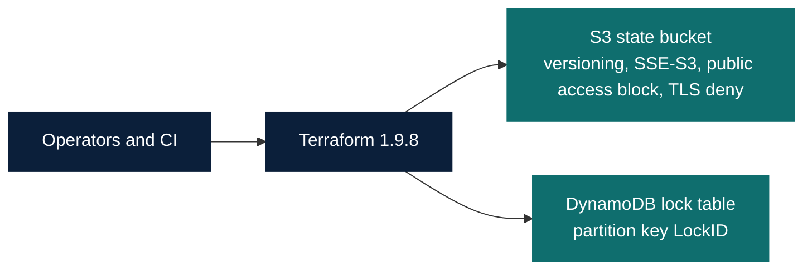
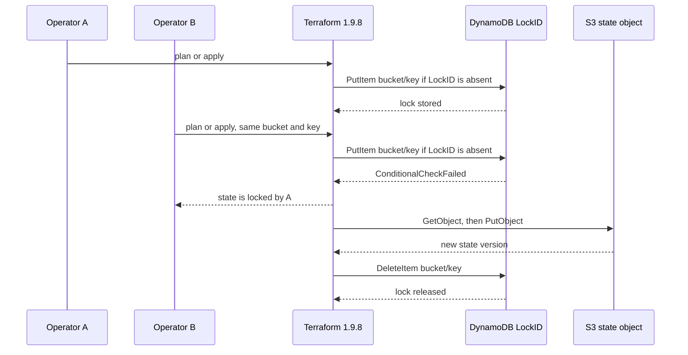

# Terraform remote state: S3 and DynamoDB locking

Portfolio demonstration of a shared S3 state bucket, a DynamoDB lock table, and a second Terraform root that uses that backend. Bootstrap state stays on disk. No AWS account is required to review or validate it.

## 1. Overview

One bucket holds a separate state object per environment key. One DynamoDB table locks all of those objects. Terraform 1.9.8 writes a lock item with `attribute_not_exists(LockID)` before it reads or writes the object, and deletes that item when the operation finishes.

The runnable check is local: policy tests, an in-process lock simulation, `terraform fmt`, and `terraform validate` after `init -backend=false`.

## 2. Professional experience versus portfolio demonstration

The resume bullet — remote state in Amazon S3 with DynamoDB locking for concurrent team use — describes earlier professional work. This repository does not contain that employer's code, account, bucket, or pipeline.

There is no recorded implementation date for the original work. The Terraform 1.9.8 pin is a compatibility choice for this demonstration. It is not evidence of when the professional system was built, and it is not a claim that 1.9.8 was the only release that could lock with DynamoDB.

No production apply, migration, cost, or reliability number is claimed here.

## 3. Problem statement

Local state does not serialize two applies. Two processes can read the same snapshot and write two different successors. The second write drops the first process's resources from state while those resources still exist, or the reverse.

A shared object fixes visibility. It does not, by itself, stop the race. The lock has to fail the second writer before that writer uploads a new object.

## 4. Architecture and diagrams





Sources: [architecture](docs/architecture.md), [locking sequence](docs/locking-sequence.md).

Bootstrap creates the bucket and the table. Each consumer root is configured with one key. The four keys are examples, not workspaces:

| Key | Role |
|-----|------|
| `env/dev/terraform.tfstate` | Example dev root |
| `env/sit/terraform.tfstate` | Example sit root |
| `env/uat/terraform.tfstate` | Example uat root |
| `env/prod/terraform.tfstate` | Example prod root |

`us-east-1`, `example-tfstate-bucket`, and `example-tfstate-lock` are placeholders. `EXAMPLE_ACCOUNT_ID` in the IAM documents is not an account.

## 5. Design decisions and trade-offs

| Decision | Why |
|----------|-----|
| One bucket, explicit keys | Separate roots can be granted different object ARNs. Workspaces would also require `s3:DeleteObject` on non-default workspace keys. This design does not use workspaces. |
| One lock table | Terraform 1.9 puts the bucket and key into `LockID`, so one table locks many objects. |
| SSE-S3 (`AES256`) | Encryption at rest without a KMS key dependency. See below for when a customer-managed key is worth that dependency. |
| On-demand DynamoDB | Lock traffic is bursty. Provisioned capacity is the wrong default for a lock table. Applying it would still create a billed table, which this repo does not do. |
| No modules | Two roots and three JSON policies are the whole surface. A module would only hide that. |
| Hardcoded plan precondition | Both roots set `local.apply_allowed = false` and the `terraform_data.apply_guard` precondition checks that local. Terraform 1.9.8 rejects a precondition whose condition is the bare literal `false`, so the constant lives in a local. `-var` cannot change it. A plan fails at that precondition. `terraform validate` does not evaluate it, so a successful validate is not evidence that the guard fired. Plan was not run. Backend initialization can run before it. Editing the source removes the guard. The precondition is not a security boundary. |

Customer-managed KMS is justified when the organization needs a key policy, separate key administrators, rotation they control, or CloudTrail events for decrypt. It adds `kms:Encrypt`, `kms:Decrypt`, and `kms:GenerateDataKey` on that key, a key-policy change whenever a new role reads state, and a hard dependency on KMS availability during every state read and write. This configuration does not set `kms_key_id` or `kms_master_key_id`.

## 6. Terraform version choice

`required_version` is `~> 1.9.8` (at least 1.9.8, before 1.10.0). The AWS provider is pinned to `5.100.0`.

Terraform 1.9.8 was published on 16 October 2024. Its S3 backend documentation treats `dynamodb_table` as the locking control and does not document `use_lockfile`. The same locking argument exists on earlier Terraform 1.x releases. Pinning 1.9.8 keeps this demonstration on the pre-deprecation configuration. It does not say that no other version can use DynamoDB locking.

Terraform 1.10.0 added experimental S3 lock files. Terraform 1.11.0 marked the DynamoDB arguments deprecated. The current S3 backend page still documents those arguments as deprecated, not removed. Details and the permissions difference are in [native S3 lock files](docs/modernization-s3-lockfile.md).

The provider pin is `hashicorp/aws` `5.100.0`. The Terraform Registry page for that version states Terraform 0.13 or later. Terraform 1.9.8 satisfies that published requirement. The version is exact so `init` does not float. This is not a claim that a newer provider major is unable to run on 1.9.8.

## 7. Bootstrap and consumer configurations

`bootstrap/` is the root that would create the bucket and table. Its backend is `local`, path `terraform.tfstate`. That file and `.terraform/` are gitignored. The root does not reference an S3 backend, because it is the configuration that creates that backend.

`consumer/` is a second root. `backend "s3" {}` is partial. `backend.hcl.example` holds the placeholders: bucket, one key, region, table, and `encrypt = true`. Copy it to `backend.hcl` only for an approved AWS exercise. `backend.hcl` is gitignored. The consumer root declares no AWS resources.

```bash
# Safe local check. Does not configure the remote backend.
terraform -chdir=bootstrap init -backend=false -input=false
terraform -chdir=bootstrap validate
terraform -chdir=consumer init -backend=false -input=false
terraform -chdir=consumer validate
```

This would contact AWS and is not part of the local workflow:

```bash
terraform -chdir=consumer init -backend-config=../backend.hcl
```

## 8. Backend and locking behavior

With `dynamodb_table` unset, Terraform 1.9.8 does not lock. The example sets it.

The table needs a string partition key named `LockID`. No sort key. The client writes:

1. `PutItem` on `{bucket}/{key}` with `attribute_not_exists(LockID)`.
2. `GetItem` / `PutItem` on `{bucket}/{key}-md5` as a digest used to detect a stale read.
3. `DeleteItem` on `{bucket}/{key}` after the client has compared the lock ID.

`StateMgr` also calls `ListObjectsV2` with prefix `env:/` (the default `workspace_key_prefix`). If that call returns `AccessDenied` and the prefix is still the default, Terraform 1.9.8 logs a warning and continues with only the `default` workspace. The operator policy allows `ListBucket` only when `s3:prefix` is one of the four state keys, so a list of `env:/` does not match. That is the intended result for this design: workspace listing is denied, and default-workspace state operations still proceed. The keys use `env/dev`, not `env:`, so they do not sit under the workspace prefix.

`encrypt = true` makes the backend send SSE-S3 (`AES256`) on `PutObject`. The bucket's encryption configuration is the matching default. The 1.9 documentation leaves `encrypt` optional, so the example sets it.

The published 1.9 fine-grained DynamoDB example conditions on `{table}/{key}`. The 1.9.8 client uses `{bucket}/{key}`. The operator policy follows the client. The 1.9 page's `s3:prefix` example is the object key, not `bucket/key`. A later documentation example puts the bucket name into `s3:prefix`; that does not match the `s3:prefix` condition key, and this policy does not copy it.

## 9. Security and IAM

Bucket controls in `bootstrap/main.tf`:

- Versioning `Enabled`, so a bad write can be recovered from an older version.
- SSE-S3 `AES256`, no customer key.
- All four public-access block flags.
- Bucket policy `Deny` on `s3:*` when `aws:SecureTransport` is false, principal `*`. A deny wildcard is the TLS control. An allow wildcard is not used.

`iam/backend-operator.json` is one identity policy covering all four example keys. A production split would be a separate principal per key so the dev role cannot write `env/prod/terraform.tfstate`. The example shows the resource shape, not a combined production grant:

- `s3:ListBucket` on the bucket, only when `s3:prefix` is one of the four keys.
- `s3:GetObject` and `s3:PutObject` on those four object ARNs. `HeadObject` uses `s3:GetObject`.
- `dynamodb:DescribeTable` on the table. Describe is a table API, so it is not tied to `LeadingKeys`.
- `dynamodb:GetItem`, `PutItem`, and `DeleteItem` on the table, with `ForAllValues:StringEquals` on `dynamodb:LeadingKeys` for each `{bucket}/{key}` and `{bucket}/{key}-md5`, plus `Null` so `dynamodb:LeadingKeys` must be present. AWS documents that `ForAllValues` is true when the key is absent. The `Null` check closes that gap in the policy text. It was not evaluated in IAM.

`s3:DeleteObject` is absent. Terraform 1.9.8 does not delete the default-workspace state object. Native `.tflock` objects are also absent; they need their own `DeleteObject` and are documented separately. `s3:GetObjectVersion` and `s3:ListBucketVersions` are also absent here. They live only in `iam/state-recovery.json`.

`iam/bootstrap.json` is a different principal, scoped to the placeholder bucket ARN and the placeholder table ARN. It can create and delete the bucket and table and can set versioning, encryption, the public-access block, and the bucket policy. It also allows the bucket and table reads that AWS provider 5.100.0 performs while refreshing `aws_s3_bucket` and `aws_dynamodb_table`, including `DescribeTimeToLive`, `DescribeContinuousBackups`, `s3:GetBucketTagging`, and `dynamodb:ListTagsOfResource`. The tag reads come from that provider version's tag interceptor, which lists tags after `Read` when the resource did not set them. Those reads were taken from source, not from a plan. `s3:DeletePublicAccessBlock` is a separate destroy-only statement. The policy does not grant object reads or writes, lock-item writes, tag writes, TTL updates, or point-in-time-recovery updates.

`s3:PutBucketAcl` is not included. Provider 5.100.0 sends `CreateBucket` with canned ACL `private`. The S3 `CreateBucket` API reference says that private canned ACL, or no ACL, requires `s3:CreateBucket` only. `s3:PutBucketAcl` is required for a public or custom ACL, which this configuration does not send.

Destroying the encryption configuration calls `DeleteBucketEncryption`. The S3 API reference authorizes that call as `s3:PutEncryptionConfiguration`, which is already on the bucket statement. That mapping was not checked with IAM.

The DynamoDB table enables AWS-owned encryption and does not set a KMS key. Point-in-time recovery is left off. Locking does not require it, and it is a billed feature.

## 10. Concurrency and failure scenarios

Concurrent applies of the same state are unsafe because the object is a snapshot, not a merge. The second successful `PutObject` becomes the only current state.

The second operator sees a lock error that names the holder, operation, and creation time. Their upload does not run.

If the holder exits without `DeleteItem`, the item remains. The next operator is blocked even though nobody is writing. That stale item has to be investigated. The S3 object may be the pre-crash version or a version the crashed process finished writing. The lock record does not answer that.

`terraform force-unlock LOCK_ID` is break-glass. `LOCK_ID` is the UUID Terraform prints in the lock error. The 1.9.8 client checks that UUID and then calls `DeleteItem` with no condition. It is unsafe while the original process is still alive, because the next writer can replace the object underneath the first process. Force-unlock does not restore an older object version.

`src/locksim.py` is an in-process simulation of one holder, a rejected second acquire, and a lock that remains after the holder stops. It is not DynamoDB, and it is not Terraform's lock client. Its `release` checks an owner string. Its `force_unlock` deletes by partition key and does not look at a UUID.

## 11. State versioning and recovery

Versioning matters because the current key can be replaced by a partial or wrong snapshot. An older version is the recovery point. Versioning is not a lock, and deleting a lock does not select a version.

Identify a candidate by `VersionId` and `LastModified`. Listing and reading that version require `iam/state-recovery.json` (`s3:ListBucketVersions` and `s3:GetObjectVersion` on the four example keys only). Copy the version outside the repository and review it there. Do not cat state into logs or commit it. State is an inventory of infrastructure and often contains sensitive values.

Put the reviewed object back with the operator policy's `s3:PutObject`, only while a lock is held and other writers are stopped. The everyday operator policy cannot read non-current versions. Practice against a disposable bucket. The steps are in [RUNBOOK.md](docs/RUNBOOK.md). They were not executed, and the recovery policy was not evaluated in IAM.

## 12. Local setup and validation

Requires Terraform 1.9.8 and Python 3. No AWS credentials.

```bash
cd projects/terraform-remote-state
python3 -m pytest -q
python3 scripts/demo-lock.py
# Use Terraform 1.9.8 on PATH. Terraform 1.10 or later fails the required_version pin.
./scripts/validate.sh
```

`./scripts/validate.sh` checks the Terraform version, scans the identity policies, refuses `terraform plan` and `terraform apply` lines under the configuration directories, runs `terraform fmt -check`, then `init -backend=false` and `validate` in `bootstrap/` and `consumer/`.

From the repository root, `./scripts/verify-portfolio.sh` includes those commands. That script also runs the other portfolio projects.

AWS CLI commands, `terraform init -backend-config=...`, `terraform plan`, and `terraform apply` need an account and are out of scope.

## 13. Testing and observed results

| Check | What it actually does |
|-------|------------------------|
| `tests/test_backend_contract.py` | Parses the HCL and IAM JSON. Asserts keys, schema, encryption, public-access block, TLS deny, policy scope, and the absence of credential fields. |
| `tests/test_iam_policy.py` | Rejects `Allow` on `*` and on `s3:*`. Allows the TLS `Deny` on `s3:*`. |
| `tests/test_lock.py` | Runs the in-process simulator, including an abandoned lock. |
| `terraform fmt` / `validate` | Formats and validates both roots offline. |
| Live AWS | Not run. Not labeled as an integration test. |

Observed on this machine after the commands in section 12:

```text
python3 -m pytest -q
27 passed

python3 scripts/demo-lock.py
in-process lock simulation (not DynamoDB, no AWS API calls)
  team-a: acquired
  team-b: blocked: LockID EXAMPLE_STATE_BUCKET/env/dev/terraform.tfstate held by team-a (OperationTypeApply)
  after_release: team-b
release transferred the lock; no cloud resources were created

./scripts/validate.sh
IAM policy check passed for bootstrap, consumer, iam
Using previously-installed hashicorp/aws v5.100.0
Success! The configuration is valid.
Success! The configuration is valid.
terraform validate passed for bootstrap and consumer; no AWS resources were created
```

Terraform reported `Terraform v1.9.8`. `./scripts/validate.sh` reused `hashicorp/aws v5.100.0` and printed `Success! The configuration is valid.` for both roots. That success does not evaluate the precondition. `./scripts/verify-portfolio.sh` then exited 0. Its remote-state pytest line was `27 passed`. Checkout-api reported `10 passed, 1 warning`, canary `11 passed`, incident lab `7 passed`. The script ended with `portfolio verification passed; no cloud resources were created`. `terraform plan` and `terraform apply` were not run, so the expected precondition failure was not executed.

## 14. Limitations

- No AWS account, apply, or IAM simulator was used. The bootstrap reads match provider 5.100.0 source. They were not confirmed against IAM.
- `terraform validate` does not evaluate the hardcoded precondition, so it does not prove the apply guard. The condition is `local.apply_allowed`, and that local is `false`. A plan should fail at that precondition. Plan was not run. Backend initialization can run before it, and editing the source removes the guard. The precondition is not a security boundary.
- `ListBucket` with `StringEquals` on the full key is the 1.9 fine-grained pattern. It was compared with the 1.9.8 `Workspaces()` prefix `env:/` in source, and it was not executed against IAM.
- The digest item uses `PutItem` without a condition. A second writer cannot reach it while the lock is held. The policy still allows that key.
- Bootstrap `s3:CreateBucket` is scoped to the bucket ARN. Some organizations also require an account-level condition. That was not tested.
- The portfolio gallery diagram `docs/architecture/rendered/03-terraform-remote-state.svg` shows Terraform 1.9.8, the S3 bucket controls, and the DynamoDB `LockID` table. It matches this configuration.
- Placeholder names are not globally unique. They must be replaced before any future approved apply. This tree does not apply them.

## 15. Native S3 lock-file modernization

S3 can lock state itself from Terraform 1.10, using `{key}.tflock`. Terraform 1.11 deprecates DynamoDB locking and does not remove it in the current documentation. This demonstration does not set `use_lockfile` and does not grant `DeleteObject` on a lock object.

The migration order, the extra object permissions, and the rollback risk of dropping DynamoDB while older clients still run are in [docs/modernization-s3-lockfile.md](docs/modernization-s3-lockfile.md). No migration was performed.

## 16. Interview discussion points

**Why is the lock a conditional put, not a get-then-put?** Two clients can both observe an empty key and both write. `attribute_not_exists(LockID)` makes the write fail if the item appeared in between.

**Why is the lock id `bucket/key` rather than the table name?** One table is shared. Terraform 1.9.8's client sets `LockID` to `bucket + "/" + key`. A policy that copies the documentation example `{table}/{key}` does not match the item the client writes.

**Why is `s3:DeleteObject` missing on the state object?** The 1.9 backend docs say the state object is not deleted. Adding delete "to be safe" lets a principal destroy history's current version. Native lock files are a different object and do need delete. Mixing those two permissions is the mistake.

**Why can the TLS policy use `s3:*` and the operator policy cannot?** The TLS statement is `Deny` for unencrypted transport. `Allow` on `s3:*` would grant every bucket API, including delete and policy changes.

**What does the second operator do?** Stop. The error names the holder. Taking the lock with `force-unlock` while that process runs can corrupt state. A stale lock is a dead holder plus a version review, not a routine unlock.

**Why is bootstrap local?** The backend cannot be a prerequisite for creating itself. Local state for that one root is gitignored. Losing it means the bucket and table must be imported before another bootstrap apply. It does not lose the consumer state objects.

**Why SSE-S3 here?** It encrypts the object without operating a CMK. Choose KMS when key administrators and decrypt audit are requirements, and budget the extra IAM and the availability coupling.

**What did this repository actually prove?** The configuration validates on Terraform 1.9.8, the policy files match the intended scope, and the simulator enforces one in-process holder. Validate does not exercise the apply guard. Nothing here proved an AWS apply or an IAM decision.
