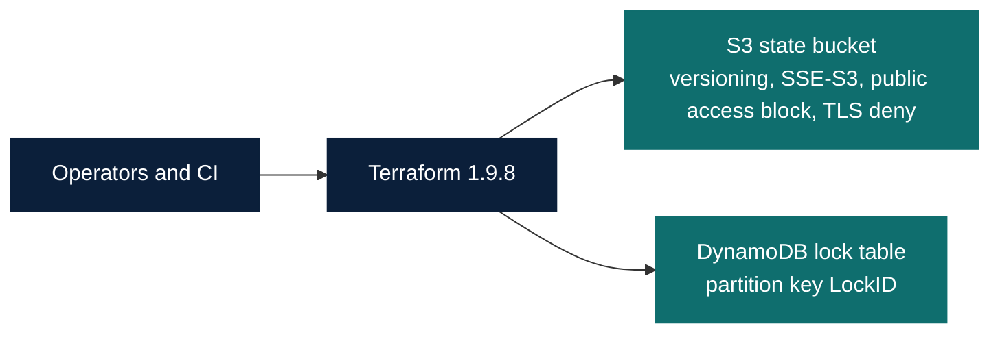

# Backend architecture

Operators and CI run Terraform. Terraform stores state in one S3 bucket and takes a lock in one DynamoDB table. Bootstrap creates those two resources with a local backend. Each consumer root selects its own state key. This demonstration does not use workspaces, a VPC, or a cluster.

Example keys in the shared bucket:

- `env/dev/terraform.tfstate`
- `env/sit/terraform.tfstate`
- `env/uat/terraform.tfstate`
- `env/prod/terraform.tfstate`

The DynamoDB lock id for Terraform 1.9.8 is `{bucket}/{key}`, plus a digest item `{bucket}/{key}-md5`.
