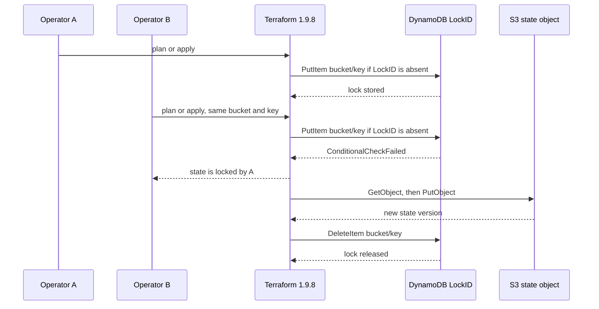

# Lock sequence

Terraform 1.9.8 writes the lock with `PutItem` and `ConditionExpression = attribute_not_exists(LockID)`. A second writer against the same bucket and key loses that condition. The lock owner then reads and writes the state object. After the operation, Terraform reads the lock, checks the lock ID, and `DeleteItem`s it.

The in-process simulator in `src/locksim.py` demonstrates the same mutual exclusion. It does not call DynamoDB.

A competing operation is rejected before it writes state. Releasing the lock does not roll state back. `force-unlock` deletes the lock item and is not a state restore.
